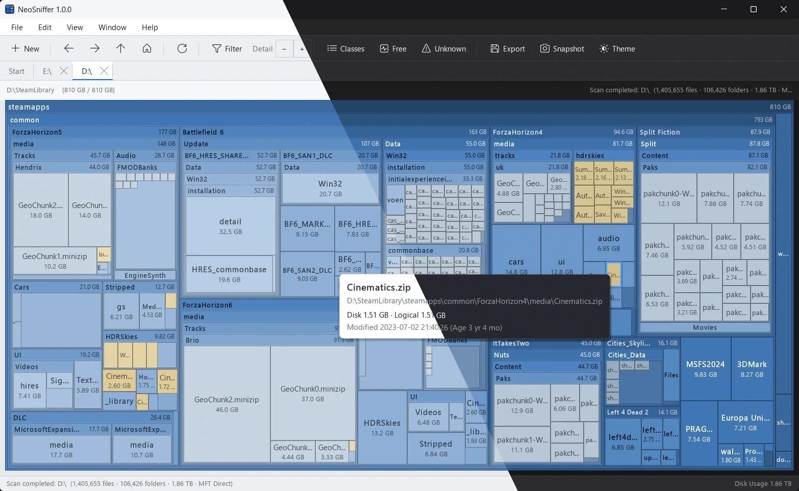

# NeoSniffer

**English** | [中文](README_CN.md)

A lightweight native Win32 disk space analyzer with a V-Sync Direct2D treemap,
Per-Monitor V2 DPI, dark mode, direct NTFS `$MFT` scanning, and a read-only MCP server.

[Download NeoSniffer for Windows](https://github.com/yssite/neosniffer/releases/latest)



## Features

| Feature | Details |
|---|---|
| Extremely Light | The whole app is a **single ~1.7 MB exe** - statically linked, no installer, no runtime, no third-party DLLs. Only Windows system DLLs are used. |
| High DPI | Per-Monitor V2, layout recalculated per paint |
| Dark / light theme | Custom-drawn menu bar, popups, tooltips, dialogs |
| NTFS `$MFT` direct read | Reads the MFT run list directly; needs admin, falls back to a parallel directory walk automatically |
| Nested treemap | Hardware-accelerated Direct2D and V-Sync by default on supported devices, with GDI fallback |
| Filter DSL | e.g. `*.iso;>1gb;>2weeks;:red` |
| Export | Template DSL (`{script}`, `if X ? {a} : {b}`, `leftpad/rightpad`) |
| Snapshots | `.ssx` (native) / `.sns` (SpaceSniffer-compatible, read) / `.du` (text) |
| i18n | Chinese / English, follows the system language by default |
| Shell integration | “Analyze with NeoSniffer” in folder / background / drive context menus |
| MCP server | stdio JSON-RPC, 11 read-only tools |

## Requirements

- Windows 10 / 11 (x64 or ARM64)
- To build: [llvm-mingw](https://github.com/mstorsjo/llvm-mingw) 20.x with clang 20 and lld

## Build

```powershell
# x64
powershell -ExecutionPolicy Bypass -File build.ps1

# Windows on ARM (cross-compile on x64)
powershell -ExecutionPolicy Bypass -File build.ps1 -Target arm64

# unit tests
powershell -ExecutionPolicy Bypass -File build.ps1 -Test
```

Output: `out\NeoSniffer.exe`, `out\NeoSniffer.Mcp.exe`.

## Usage

Double-click the exe and pick a drive, or drop a folder into the window.
Double-click a box to drill in. Press `Backspace` to go back.
To switch between Direct2D and GDI, open **Settings → Appearance → Renderer (after restart)**.
The new selection takes effect the next time you start NeoSniffer.

Command line:

```powershell
NeoSniffer.exe scan D:\
NeoSniffer.exe scan D:\ scan E:\
NeoSniffer.exe load snapshot.ssx filter "*.iso;>1gb"
NeoSniffer.exe scan D:\ export "Summary" "report.txt" autoclose
```

## MCP server

`NeoSniffer.Mcp.exe` speaks JSON-RPC over stdio. Tools: `scan`, `list_children`,
`largest_files`, `largest_folders`, `search`, `tree`, `file_types`,
`duplicates`, `cleanup_candidates`, `volume_info`, `export_report`.

In 1.1, `export_report` accepts `path`, optional `config` (default `Summary`) and optional
`max_nodes`. It returns report text and a `truncated` flag through MCP. The former
`output` argument has been removed. File exports are available from the desktop app or CLI.
Duplicate and cleanup results are candidates for manual review. Scan totals cover
discovered files, and used, free, and total volume bytes are reported separately.

```json
{
  "mcpServers": {
    "neosniffer": {
      "command": "C:\\Tools\\NeoSniffer\\NeoSniffer.Mcp.exe",
      "args": []
    }
  }
}
```

## Known limitations

- Cancelling UAC at startup continues in standard-user mode with directory enumeration.
- NTFS tests use synthetic records. Native 4Kn drives and unusual UNC paths have limited hardware coverage.

## Disclaimer

NeoSniffer is an **unofficial, independent reimplementation**. It contains no code from the
original SpaceSniffer by Umberto Uderzo and is not affiliated with or endorsed by its author.
It can read SpaceSniffer snapshot and configuration files for interoperability only.

## License

MIT — see [LICENSE](LICENSE).
