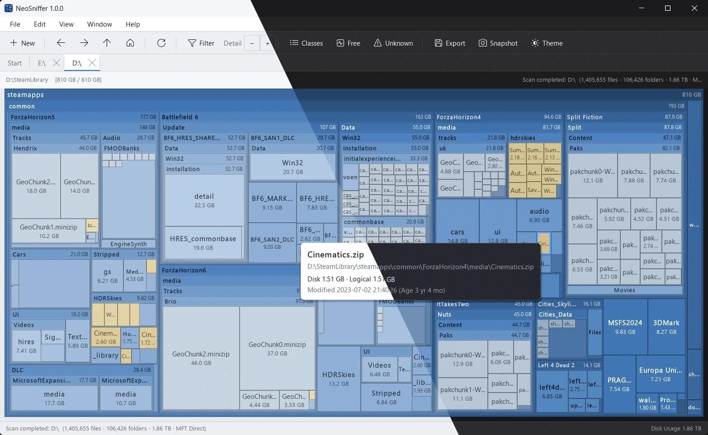

# NeoSniffer

[English](README.md) | **中文**

原生 Win32 / C++20 单文件磁盘空间分析工具：Per-Monitor V2 高 DPI、深色模式、
NTFS `\` 直读，并内置面向 AI Agent 的只读 MCP 服务。

## 特性

| 特性 | 说明 |
|---|---|
| 原生、零依赖 | 单个约 1.7 MB 的 exe，静态链接，只依赖系统 DLL |
| 高 DPI | Per-Monitor V2，每次绘制按当前客户区重算布局 |
| 深色 / 浅色 | 菜单栏、弹出菜单、提示卡片、对话框全部自绘 |
| NTFS `\` 直读 | 直接解析 MFT run list；需管理员，失败自动回退到并行目录枚举 |
| 嵌套树图 | 容器标题带、逐层内缩、分档标签、180 ms 缩放动画 |
| 过滤器 DSL | 例如 `*.iso;>1gb;>2weeks;:red` |
| 导出 | 模板 DSL（`{script}`、`if X ? {a} : {b}`、`leftpad/rightpad`） |
| 快照 | `.ssx`（自有）/ `.sns`（兼容 SpaceSniffer，只读）/ `.du`（文本） |
| 中英双语 | 默认跟随系统语言 |
| 资源管理器集成 | 文件夹 / 目录空白处 / 盘符右键「使用 NeoSniffer 分析占用」 |
| MCP 服务 | stdio JSON-RPC，11 个只读工具 |

## 环境要求

- Windows 10 / 11（x64 或 ARM64）
- 自行编译需要 [llvm-mingw](https://github.com/mstorsjo/llvm-mingw) 20.x（clang 20 + lld）

## 编译

`powershell
# x64
powershell -ExecutionPolicy Bypass -File build.ps1

# Windows on ARM（在 x64 上交叉编译）
powershell -ExecutionPolicy Bypass -File build.ps1 -Target arm64

# 单元测试
powershell -ExecutionPolicy Bypass -File build.ps1 -Test
`

产物：`out\NeoSniffer.exe`、`out\NeoSniffer.Mcp.exe`。

## 使用

双击 exe，选择驱动器；也可以把文件夹拖进窗口。
双击某个方块下钻，`Backspace` 返回上一层。

命令行：

`
NeoSniffer.exe scan   D:\
NeoSniffer.exe scan   D:\ ; E:\                （分号分隔多个）
NeoSniffer.exe load   snapshot.ssx
NeoSniffer.exe filter "*.iso;>1gb"
NeoSniffer.exe export "report.html"
NeoSniffer.exe scan D:\ ; autoclose
`

## MCP 服务

`NeoSniffer.Mcp.exe` 通过 stdio 提供 JSON-RPC。工具：`scan`、`list_children`、
`largest_files`、`largest_folders`、`search`、`tree`、`file_types`、
`duplicates`、`cleanup_candidates`、`volume_info`、`export_report`。

`json
{
  "mcpServers": {
    "neosniffer": {
      "command": "C:\\\\Tools\\\\NeoSniffer\\\\NeoSniffer.Mcp.exe",
      "args": []
    }
  }
}
`

## 已知限制

- `alwaysRunAsAdmin` 目前没有兜底：UAC 被取消时程序会直接退出，不显示窗口。
- 管理员模式下 `\` 合并经过单元测试与卷总量交叉校验，但未覆盖所有文件系统边角。
- 超过 `MAX_PATH` 的路径用 `\\\\?\\` 前缀处理，极端 UNC 路径未实测。
- 内部审查剩余 28 项 P1，记录在 `docs/CODE_REVIEW.md`。

## 免责声明

NeoSniffer 是**非官方、独立重新实现**，不含 Umberto Uderzo 原作 SpaceSniffer 的任何代码，
与原作者无隶属或背书关系；仅为实现互操作性而读取其快照与配置格式。

## 许可证

MIT，见 [LICENSE](LICENSE)。
